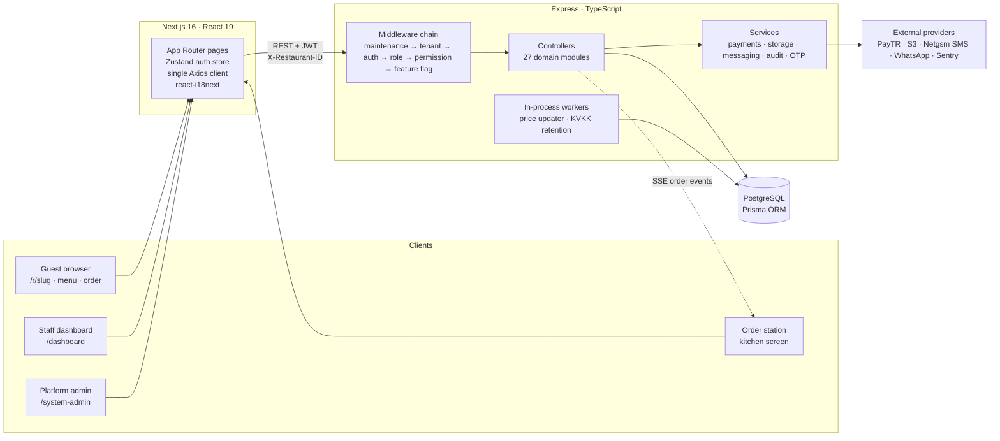
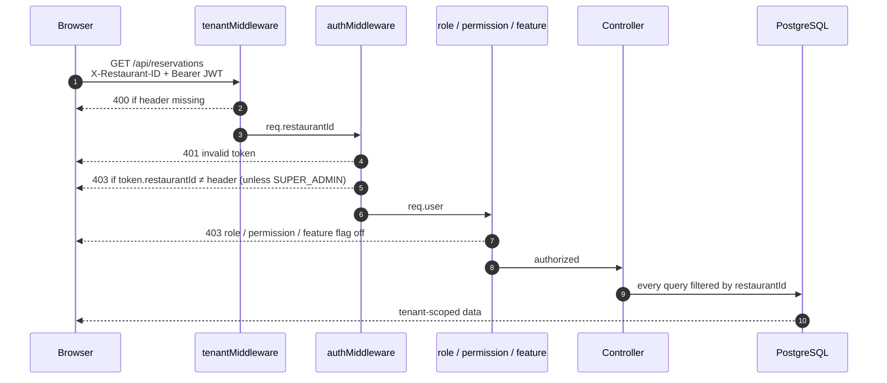
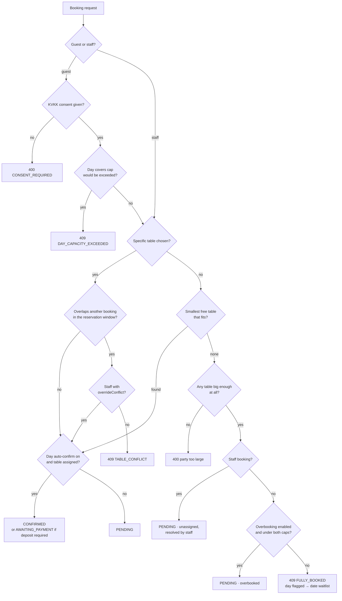
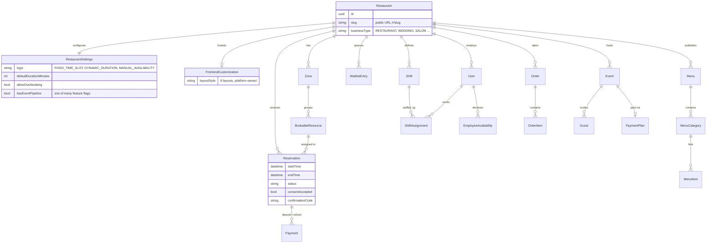
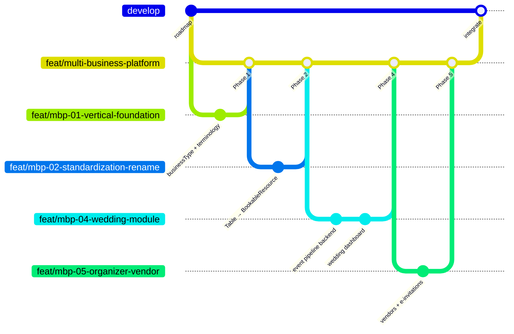

# Rezervelik

**Multi-tenant SaaS for restaurants and booking-based businesses** — reservations, floor plans, QR menus, waitlists, staff scheduling, online ordering and per-tenant branded booking pages, served from one backend, one database and one frontend.

[](https://github.com/erdeemaydin/rezervelik/actions/workflows/ci.yml)


<!--
  Screenshots: add images under docs/screenshots/ and reference them here, e.g.
  
-->

| | |
|---|---|
| **Live demo** | [ayd-dine.duckdns.org](https://ayd-dine.duckdns.org) |
| **Built** | April – September 2026 · ~330 commits · 18 integration merges |
| **Status** | Deployed to a production VPS (Nginx · pm2 · PostgreSQL · daily backups) |
| **Scope** | 27 controllers · 40+ Prisma models · 14 migrations · 60+ API integration test suites |
| **Languages** | Turkish and English, end to end (dashboard, public pages, API error messages) |

---

## Contents

- [What it does](#what-it-does)
- [Architecture](#architecture)
- [Key engineering decisions](#key-engineering-decisions)
- [Quality & delivery](#quality--delivery)
- [How I worked](#how-i-worked)
- [Getting started](#getting-started)
- [Documentation map](#documentation-map)

---

## What it does

**For guests** — a branded public page per tenant (`/r/<slug>`) with eight curated layouts, live availability, booking with KVKK consent, a date waitlist when a day is full, a QR-friendly menu-only view, e-invitations with RSVP, and online ordering with delivery-zone checks.

**For tenant staff** (`/dashboard`)

| Area | Highlights |
|---|---|
| Reservations | List, calendar and Gantt-style timeline; three booking modes; conflict detection with staff override; opt-in overbooking caps; no-show history per phone number |
| Floor plan | Drag-and-drop editor on a fixed logical canvas that scales to any screen |
| Host console & waitlist | Real-time walk-in queue, wait-time estimates, offer/accept links |
| Menus | Categories, modifiers, pairings, dietary/regulatory fields, QR codes, printable PDF, **scheduled bulk price updates** (background worker) |
| Staff | Shift requirements per weekday, assignment with `DOUBLE_SHIFT` / 11-hour `CONSECUTIVE_REST` / availability warnings, time clock and worked hours |
| Orders | Order station with live updates (SSE), order settings, delivery zones, printable tickets |
| Events | Wedding/event pipeline (lead → contract → completed), installment plans, guest list & seating, vendors |
| Insights | Analytics, payments, reviews, audit log |
| Branding | Colors, typography, announcement banner, about/legal/privacy text, live preview |

**For the platform owner** (`/system-admin`) — tenant provisioning, subscriptions, per-tenant feature flags and add-on packages, layout selection, currency/2FA/language defaults, root and restricted sub-admins, maintenance mode, platform audit log.

---

## Architecture



### Request pipeline: how tenant isolation is enforced

Every tenant-scoped request passes the same chain. The tenant header alone is never trusted: the JWT has to belong to the same tenant.



### Reservation decision flow

The booking engine has to balance "never double-book a table" against real restaurant behaviour (staff overrides, overbooking, walk-ins).



The cap and overbooking counts are re-read inside the same database transaction as the insert, so two simultaneous bookings cannot both slip past a limit.

### Core data model (excerpt)



The full schema is in [`prisma/schema.prisma`](prisma/schema.prisma). The domain rules behind it are in [`docs/architecture/PROJECT_LOGIC.md`](docs/architecture/PROJECT_LOGIC.md).

---

## Key engineering decisions

| Decision | Why |
|---|---|
| **Shared database, row-level tenancy** (`restaurantId` on every row, header + JWT cross-check) | One deployment to operate; isolation is enforced in one middleware chain and covered by dedicated cross-tenant tests |
| **One platform, many verticals** instead of forking for weddings, salons, clinics… | About 70% of the value (auth, RBAC, 2FA, i18n, payments, scheduling, CMS) is shared. Verticals are a `businessType` with terminology tables and feature-flag profiles. See [Multi-business roadmap](docs/planning/MULTI_BUSINESS_ROADMAP.md) §1 |
| **Provider interfaces with mock implementations** for payments (PayTR), storage (S3 / local disk) and messaging (SMS / WhatsApp) | The full flow runs end to end without real accounts. Going live means swapping a provider, not rewriting features ([Mock implementations](docs/engineering/MOCK_IMPLEMENTATIONS.md)) |
| **Hosted payment iframe** over direct card API | Keeps PCI scope at SAQ A ([Payments design](docs/architecture/PAYMENTS.md)) |
| **Design choices that affect the product are platform-owned** (layout, add-on packages, currency) | Tenants customize branding, not architecture, so support stays predictable |
| **Same database engine everywhere** (PostgreSQL in prod, dev, CI and tests) | Removed a whole class of "works on SQLite" bugs. Migrations were squashed to one clean baseline when switching |
| **Standard error envelope** `{ code, error, message, details }` with i18n keys | The frontend shows localized, field-level errors without guessing |
| **KVKK by design**: server-enforced consent, separate marketing opt-in, daily anonymization worker | Turkish data protection law; the platform is the data processor, each tenant the controller |

---

## Quality & delivery

- **Tests on real PostgreSQL.** Vitest + Supertest, an isolated test database provisioned automatically (container locally, service container in CI).
- **What is tested** is the risky stuff: cross-tenant access and IDOR, role escalation, 2FA bypass, rate limits, XSS in tenant HTML, race conditions (double assignment, waitlist offer acceptance, RSVP and vendor linking), timezone handling in analytics, payment refunds.
- **CI gate** ([`ci.yml`](.github/workflows/ci.yml)): blocking `npm audit`, migrations, tests, type-check and build for the backend; lint, types, unit tests and build for the frontend. Post-deploy smoke test ([`smoke.yml`](.github/workflows/smoke.yml)), Dependabot.
- **Operations**: written runbooks for [server setup](docs/operations/SERVER_SETUP.md), [database backups & restore](docs/operations/DATABASE_RUNBOOK.md), [staging](docs/operations/STAGING.md), [monitoring](docs/operations/MONITORING.md) and a [pre-deploy checklist](docs/operations/PRE_DEPLOY_SMOKE_CHECKLIST.md).

---

## How I worked

I built this as a solo product owner and engineer, using AI coding agents (Claude Code, Gemini) to implement. Product scope, architecture, sequencing, review and the merge decisions were mine. The repository is set up so that this process is visible.

**1. Plan before building.** Every larger initiative starts as a written plan with decisions, phases and checkboxes, and is updated as the work ships:

- [Production roadmap](docs/planning/PRODUCTION_ROADMAP.md): security, KVKK, ops and payments gaps before going live
- [Multi-business roadmap](docs/planning/MULTI_BUSINESS_ROADMAP.md): turning a restaurant tool into a multi-vertical platform, including a per-phase build log
- [Online ordering plan](docs/packaging/online-ordering-plan.md), [spec](docs/packaging/online-ordering-spec.md) and [v3 plan](docs/packaging/online-ordering-v3-plan.md)

**2. One branch per phase, merged when green.** For example, the multi-business initiative:



Branching and release rules are in [Git workflow](docs/engineering/GIT_WORKFLOW.md). Commits follow `type(scope): summary`.

**3. Give agents a contract, not a prompt.** [`CLAUDE.md`](CLAUDE.md) defines the architecture rules every change must respect: tenant scoping, i18n in both languages, never exposing raw IDs, which settings are platform-only. Agent output is reviewed against it and against the tests. Commits that an AI agent co-wrote carry a `Co-Authored-By` trailer, so the history is transparent about it.

**4. Keep a journal.** [Progress log](docs/journal/PROGRESS.md) and [work log](docs/journal/WORK_LOG.md) record what was done, what was found during audits, and what was deliberately postponed.

---

## Getting started

**Requirements:** Node.js 20+, and PostgreSQL 16 or Podman/Docker for the test database.

```bash
# Backend (repo root, port 3000)
cp .env.example .env              # set DATABASE_URL, JWT_SECRET, SETUP_SECRET_TOKEN
npm install
npx prisma migrate deploy
npx ts-node prisma/seed.ts        # demo tenant "gourmet-bistro"
npm run dev

# Frontend (port 3001)
cd frontend
cp .env.example .env
npm install
npm run dev
```

Open <http://localhost:3001/r/gourmet-bistro> for the public page, or log in at `/auth/login` with `admin@gourmetbistro.com` / `password123`.
To fill a day with realistic data: `npm run demo -- --restaurant gourmet-bistro --date 2026-09-01`.

```bash
# Tests
npm run test:setup-db   # starts a throwaway Postgres on :5433 (or uses TEST_DATABASE_URL)
npm test
cd frontend && npm run lint && npm test
```

---

## Documentation map

| Folder | Contents |
|---|---|
| [`docs/architecture`](docs/architecture) | [Domain logic](docs/architecture/PROJECT_LOGIC.md) · [API reference](docs/architecture/API_DOCS.md) · [Payments design](docs/architecture/PAYMENTS.md) |
| [`docs/planning`](docs/planning) | [Roadmap](docs/planning/ROADMAP.md) · [Production roadmap](docs/planning/PRODUCTION_ROADMAP.md) · [Multi-business roadmap](docs/planning/MULTI_BUSINESS_ROADMAP.md) · [Feature opportunities](docs/planning/FEATURE_OPPORTUNITIES.md) |
| [`docs/packaging`](docs/packaging) | Add-on packages (hosted site, widget) and online ordering plans |
| [`docs/engineering`](docs/engineering) | [Git workflow](docs/engineering/GIT_WORKFLOW.md) · [Testing & CI/CD](docs/engineering/TESTING_AND_CICD.md) · [Mock implementations](docs/engineering/MOCK_IMPLEMENTATIONS.md) |
| [`docs/operations`](docs/operations) | Server setup · Staging · Database runbook · Monitoring · Pre-deploy checklist |
| [`docs/journal`](docs/journal) | Progress log, work log, daily summaries |

---

## License

© 2026 Muhammed Erdem Aydin. All rights reserved. The source is public for portfolio and review purposes. Please ask before reusing it.
